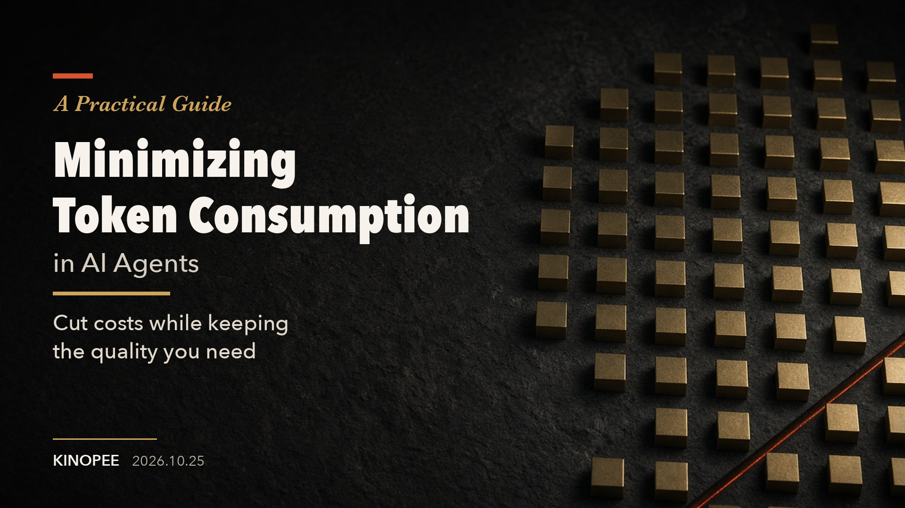

# A Practical Guide to Minimizing Token Consumption in AI Agents

[日本語](./README.md) | English

A practical guide to cutting wasteful token consumption by reviewing an AI agent's input, context, tool execution, verification, and model selection. The goal is to lower the total cost per task that passes verification, while meeting the required quality and completion time.

The full guide is in [ai-agent-token-guide.en.md](./ai-agent-token-guide.en.md). The Japanese original is [ai-agent-token-guide.md](./ai-agent-token-guide.md).

If you find any mistakes, please send a PR.

October 25, 2026 · [Kinopee](https://x.com/kinopee_ai)
