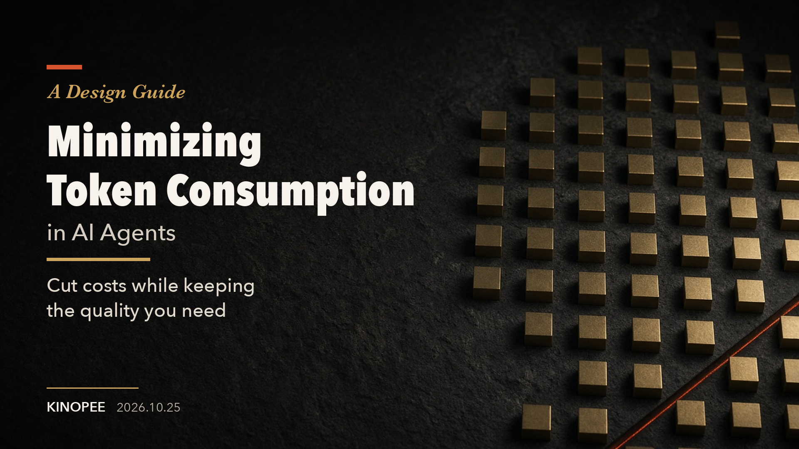

# A Design Guide to Minimizing Token Consumption in AI Agents

[日本語](./README.ja.md) | English

A design guide to cutting wasteful token consumption by reviewing an AI agent's input, context, tool execution, verification, and model selection. The goal is to lower the total cost per task that passes verification, while meeting the required quality and completion time.

The full guide is in [ai-agent-token-guide.md](./ai-agent-token-guide.md). The Japanese original is [ai-agent-token-guide.ja.md](./ai-agent-token-guide.ja.md).

## The eight principles

1. [Reduce input](./ai-agent-token-guide.md#principle-1-reduce-input)
2. [Manage context lifetime](./ai-agent-token-guide.md#principle-2-manage-context-lifetime)
3. [Reduce round trips](./ai-agent-token-guide.md#principle-3-reduce-round-trips)
4. [Stop rework early (task design and verifiers)](./ai-agent-token-guide.md#principle-4-stop-rework-early-task-design-and-verifiers)
5. [Reduce output](./ai-agent-token-guide.md#principle-5-reduce-output)
6. [Don't break the prompt cache](./ai-agent-token-guide.md#principle-6-dont-break-the-prompt-cache)
7. [Match the model and reasoning effort to the task](./ai-agent-token-guide.md#principle-7-match-the-model-and-reasoning-effort-to-the-task)
8. [Measure before you optimize](./ai-agent-token-guide.md#principle-8-measure-before-you-optimize)

If you're not sure where to start, begin with "[What you can do today](./ai-agent-token-guide.md#what-you-can-do-today-no-configuration-changes)" in the [adoption priority checklist](./ai-agent-token-guide.md#adoption-priority-checklist). Those items don't require any configuration changes.

If you find any mistakes, please send a PR.

## License

The text and images are licensed under [CC BY 4.0](./LICENSE), and the code examples in the guide are licensed under [MIT](./LICENSE-CODE).

October 25, 2026 · [Kinopee](https://x.com/kinopee_ai)
